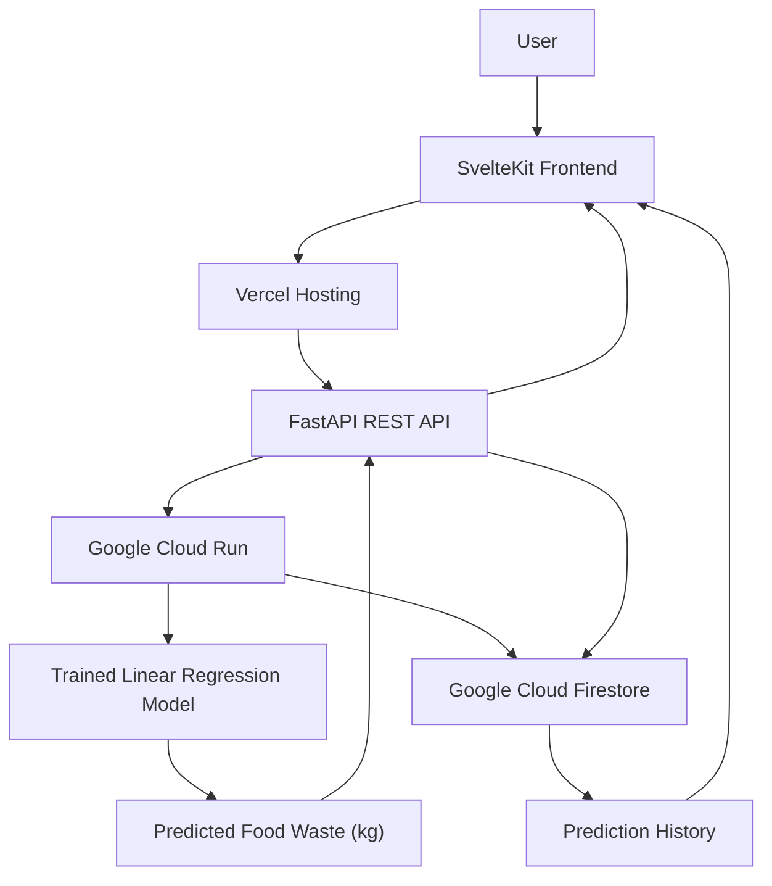

# FoodWise AI – Food Surplus and Spoilage Risk Predictor

**FoodWise AI** is a cloud-based machine learning application designed to predict food waste quantities using operational and environmental data. The system helps food service organizations estimate potential food waste and make more informed decisions about food preparation and resource management.

The application combines a trained machine learning model, a FastAPI backend deployed on Google Cloud Run, a SvelteKit frontend hosted on Vercel, and Google Cloud Firestore for storing prediction history.

## Live Application

**Try FoodWise AI:** [https://food-wise-ai-rose.vercel.app](https://food-wise-ai-rose.vercel.app)

## Project Objectives

- Predict the expected quantity of food waste in kilograms.
- Use historical and operational data to estimate food waste.
- Provide an easy-to-use interface for generating predictions.
- Store prediction records in a centralized cloud database.
- Display prediction history and analytical insights.
- Demonstrate the deployment and integration of a machine learning application using cloud services.

## System Architecture

The application follows a client-server architecture in which the frontend communicates with a cloud-hosted REST API.



### Architecture Components

| Component | Technology | Purpose |
|---|---|---|
| Frontend | SvelteKit, Svelte 5, TypeScript | User interface and interaction |
| Frontend Hosting | Vercel | Hosting the web application |
| Backend | Python, FastAPI | REST API and prediction processing |
| Machine Learning | Scikit-learn | Training and generating predictions |
| Model | Linear Regression | Predicting food waste quantity |
| Backend Hosting | Google Cloud Run | Running the containerized API |
| Database | Google Cloud Firestore | Storing prediction history |
| Containerization | Docker | Packaging the backend and trained model |
| Source Control | Git and GitHub | Version control and project management |

## Machine Learning Approach

### Dataset

The dataset was obtained from Kaggle as part of a competition dataset. The `train.csv.xlsx` file was selected for model development and evaluation.

- Original dataset: 911 records
- Number of columns: 12
- Prediction target: `food_waste_kg`
- Training and testing strategy: Chronological 80:20 split

The dataset contains operational and environmental information, including:

- Meals served
- Kitchen staff
- Temperature
- Humidity
- Day of the week
- Special events
- Past food waste
- Staff experience
- Waste category
- Food waste quantity

### Data Preprocessing and Feature Engineering

The following preprocessing steps were performed:

1. Examined the dataset structure and statistical characteristics.
2. Handled missing values in the `staff_experience` column.
3. Standardized categorical values by removing unnecessary spaces and normalizing text.
4. Extracted month and day of the month from the date column.
5. Verified the existing day-of-week values against the date.
6. Removed identifiers and redundant columns from the model features.
7. Applied numerical and categorical preprocessing using Scikit-learn pipelines.
8. Used chronological splitting to evaluate the model on later records.

### Algorithms Evaluated

Three regression algorithms were trained and compared:

1. Linear Regression
2. Random Forest Regressor
3. Gradient Boosting Regressor

### Model Performance

The models were evaluated using Mean Absolute Error (MAE), Root Mean Squared Error (RMSE), and R² Score.

| Algorithm | MAE | RMSE | R² Score |
|---|---:|---:|---:|
| Linear Regression | 4.8026 | 7.3614 | 0.9203 |
| Random Forest | 5.4281 | 8.4119 | 0.8959 |
| Gradient Boosting | 5.0024 | 8.4497 | 0.8949 |

**Selected Model: Linear Regression**

Linear Regression achieved the lowest MAE and RMSE and the highest R² score among the three evaluated models. It was therefore selected for deployment.

The trained model is saved as:

`models/food_waste_model.joblib`

Additional model evaluation files:

- `models/metrics.json`
- `models/model_comparison.csv`

## Application Features

### 1. Dashboard

Provides an overview of the FoodWise AI application and its main functionalities.

### 2. Waste Prediction

Allows users to enter operational and environmental details, including meals served, kitchen staff, temperature, humidity, staff experience, and waste category.

The application sends the input to the backend API and displays the predicted food waste quantity in kilograms.

### 3. Analytics and Insights

Provides an interface for viewing food waste-related insights and analytical information.

### 4. Prediction History

Displays previously generated predictions retrieved from Google Cloud Firestore.

Users can delete individual prediction records or clear the stored history.

### 5. About

Provides information about the project, its objectives, technologies, and implementation.

## Google Cloud Deployment

The backend and database are deployed using Google Cloud Platform.

### Google Cloud Services Used

| Service | Configuration / Purpose |
|---|---|
| Google Cloud Run | Hosts the FastAPI backend |
| Google Cloud Firestore | Stores prediction history |
| Google Cloud Build | Builds the container image during source deployment |
| Artifact Registry | Stores the container image used by Cloud Run |
| Cloud IAM | Controls the backend service identity and database permissions |

### Cloud Run Configuration

| Setting | Value |
|---|---|
| Project ID | `stone-airfoil-506110-m7` |
| Service Name | `foodwise-ai-api` |
| Region | `asia-south1` |
| Memory | 1 GiB |
| CPU | 1 |
| Minimum Instances | 0 |
| Maximum Instances | 2 |
| Port | 8080 |
| Authentication | Unauthenticated access enabled |

**Backend API URL:**

`https://foodwise-ai-api-88911246605.asia-south1.run.app`

### Firestore Configuration

- Database: `(default)`
- Database mode: Native
- Edition: Standard
- Location: `asia-south1`
- Collection: `prediction_history`

Prediction records are stored centrally in Firestore rather than in the user's browser.

### IAM and Service Account

A dedicated runtime service account was created for the Cloud Run service:

`foodwise-api-runtime@stone-airfoil-506110-m7.iam.gserviceaccount.com`

The service account was granted the `Cloud Datastore User` role (`roles/datastore.user`) to allow the backend to interact with Firestore.

The application uses the Cloud Run service identity and Application Default Credentials to access Firestore. No service account JSON key is embedded in the application.

## Backend API Endpoints

The FastAPI backend exposes the following endpoints:

| Method | Endpoint | Description |
|---|---|---|
| GET | `/health` | Checks backend health, model loading, and Firestore client initialization |
| POST | `/predict` | Generates a food waste prediction and saves the result to Firestore |
| GET | `/history` | Retrieves stored prediction records |
| DELETE | `/history/{prediction_id}` | Deletes a specific prediction record |
| DELETE | `/history` | Deletes all prediction records |
| GET | `/docs` | Opens the interactive FastAPI Swagger documentation |

### Health Check

The health endpoint reports the status of the backend and its dependencies.

Example response:

```json
{
  "status": "healthy",
  "model_loaded": true,
  "model_name": "Linear Regression",
  "target": "food_waste_kg",
  "firestore_connected": true
}
```

Note: `firestore_connected` indicates successful Firestore client initialization. Actual database write functionality was also verified through successful predictions.

### Prediction Response

Example response:

```json
{
  "prediction_id": "CZFgNMYJ6tymWBaHPnkb",
  "predicted_food_waste_kg": 52.96,
  "unit": "kg",
  "model": "Linear Regression",
  "history_saved": true
}
```

## Project Structure

```text
FoodWise-AI/
│
├── backend/
│   ├── main.py
│   └── requirements.txt
│
├── models/
│   ├── food_waste_model.joblib
│   ├── metrics.json
│   └── model_comparison.csv
│
├── frontend/
│   ├── src/
│   │   ├── lib/
│   │   │   ├── PredictionPage.svelte
│   │   │   ├── AnalyticsPage.svelte
│   │   │   ├── HistoryPage.svelte
│   │   │   └── AboutPage.svelte
│   │   ├── routes/
│   │   │   ├── +page.svelte
│   │   │   └── +layout.svelte
│   │   └── app.css
│   └── package.json
│
├── notebooks/
│   ├── 01_data_understanding.ipynb
│   └── 02_model_training.ipynb
│
├── Dockerfile
├── .dockerignore
└── README.md
```

*Note: The structure above highlights the main project components. Additional configuration and supporting files may exist in the repository.*

## Running the Project Locally

### Prerequisites

- Python 3.14 or compatible environment
- Node.js and npm
- Git
- Google Cloud SDK (for Google Cloud operations)
- Access to a Google Cloud project with Firestore configured

### 1. Clone the Repository

```bash
git clone https://github.com/saniyasawal/FoodWise-AI.git
cd FoodWise-AI
```

### 2. Set Up the Python Backend

Create and activate a virtual environment:

```cmd
python -m venv .venv
.venv\Scripts\activate
```

Install the backend dependencies:

```cmd
pip install -r backend\requirements.txt
```

Start the FastAPI server from the repository root:

```cmd
python -m uvicorn backend.main:app --reload
```

The local backend will be available at:

`http://127.0.0.1:8000`

Interactive API documentation:

`http://127.0.0.1:8000/docs`

**Firestore requirement:** The backend requires valid Google Cloud Application Default Credentials and appropriate Firestore permissions. Configure these before testing database-dependent functionality locally.

### 3. Set Up the Frontend

Open another terminal:

```cmd
cd frontend
npm install
npm run dev
```

The frontend development server will be available at the local URL displayed by Vite, typically:

`http://localhost:5173`

The frontend must be configured to communicate with the appropriate backend API URL.

## Testing and Verification

The following functionality was tested during project implementation:

- Backend health endpoint returned a healthy status.
- Trained Linear Regression model loaded successfully in Cloud Run.
- Prediction requests were processed successfully through the deployed API.
- Prediction results were saved to Firestore.
- Stored records were retrieved through the history endpoint.
- Individual prediction deletion was tested.
- Clear-history functionality was tested.
- The live Vercel frontend successfully communicated with the Cloud Run backend.
- A CORS configuration issue between the production frontend domain and backend was identified and resolved.

## Challenges Encountered

**1. Cloud Run deployment**

The initial source deployment encountered a build issue. The deployment configuration was corrected, and the backend was subsequently deployed successfully.

**2. Frontend and backend integration**

The frontend initially failed to communicate with the deployed backend due to a Cross-Origin Resource Sharing (CORS) configuration mismatch. The production Vercel domain was added to the backend's permitted origins, and Cloud Run was redeployed.

**3. Cloud database integration**

Prediction history was initially handled on the frontend. This was changed to a centralized Firestore implementation so that prediction records could be stored and retrieved through the backend API.

**4. Cloud permissions**

A dedicated runtime service account was configured and granted the required Firestore permissions so that the backend could access the database without embedding service account keys.

## Limitations and Future Enhancements

The current implementation is an academic demonstration and has some limitations:

- The model is trained on a limited dataset of 911 records.
- Prediction quality depends on the patterns and representativeness of the training dataset.
- The application does not currently provide individual user accounts or role-based access to prediction history.
- Prediction history is shared across visitors, and the delete and clear-history endpoints are not protected by user authentication.
- Some dashboard and analytics figures are illustrative rather than live aggregates calculated from Firestore.
- The model is not automatically retrained when new prediction records are added.

Potential future improvements include:

- Adding user authentication and authorization.
- Introducing user-specific prediction histories.
- Securing deletion operations with appropriate permissions.
- Integrating real-time analytics based on Firestore records.
- Collecting a larger and more diverse dataset.
- Implementing periodic model retraining and model monitoring.
- Adding more advanced regression models and comparing their performance on new data.

## Author

**Project:** Food Surplus and Spoilage Risk Predictor – FoodWise AI

**Repository:** [FoodWise-AI on GitHub](https://github.com/saniyasawal/FoodWise-AI)

**Live Application:** [https://food-wise-ai-rose.vercel.app](https://food-wise-ai-rose.vercel.app)

---

*Developed as part of the Cloud-Based AI Deployment academic project.*
